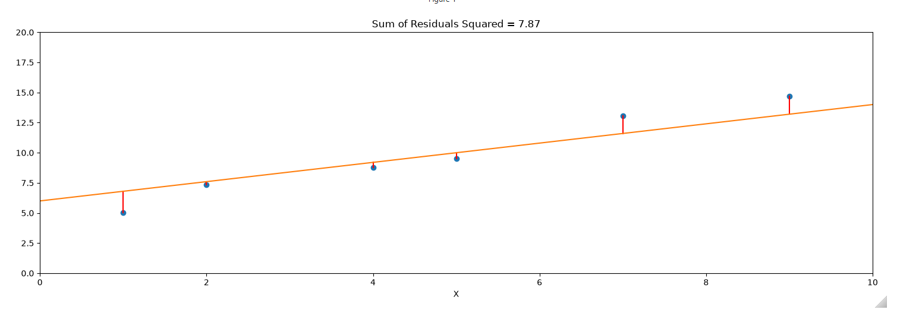

# Least Squares Demo

This interactive notebook accompanies the DSC4011M module and is designed to help students develop an intuitive understanding of residuals and least squares curve fitting for simple linear regression.

The notebook provides an interactive visualisation in which students can manipulate data points and observe how changes affect the fitted regression line and the resulting residuals. By experimenting with different datasets, students can explore:

- The meaning of a residual and how it is calculated.
- The relationship between observed values and model predictions.
- How the least squares criterion determines the best-fitting line.
- The effect of individual points and outliers on the fitted model.
- Why minimising the sum of squared residuals produces the regression line.

The aim is to complement the mathematical derivation of least squares with a visual, hands-on demonstration that encourages exploration and builds intuition.

## Requirements

The notebook requires the following Python packages:

- `numpy`
- `matplotlib`
- `ipympl`
- `ipywidgets`

## Running the Notebook

Launch the notebook in Jupyter Lab or Jupyter Notebook and execute all cells. Interactive controls are provided using `ipywidgets`, while `ipympl` enables interactive matplotlib figures within the notebook environment.

## Module Context

This resource forms part of **DSC4011M** and is intended to support teaching on linear regression, residual analysis, and least squares estimation.